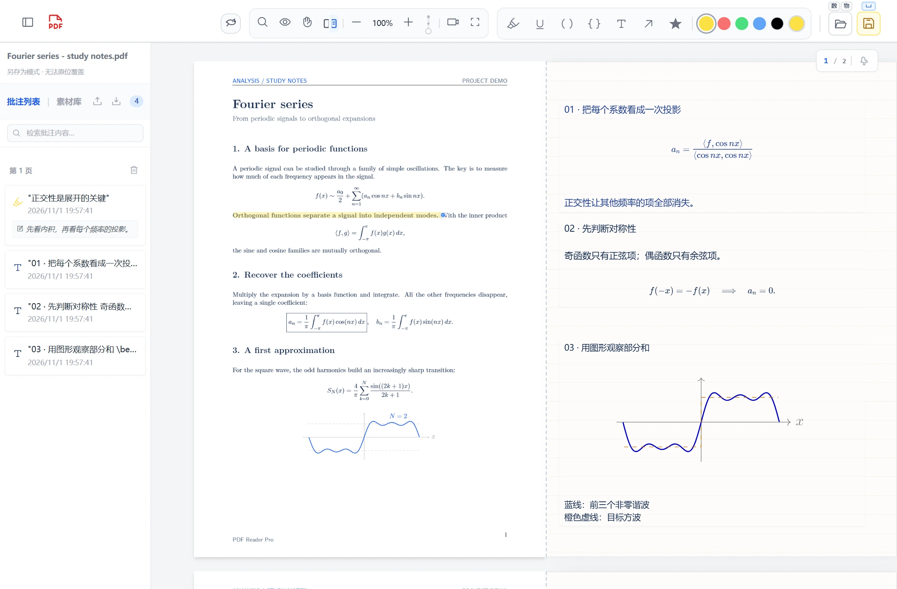
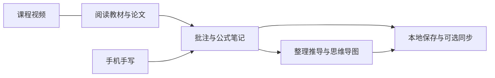
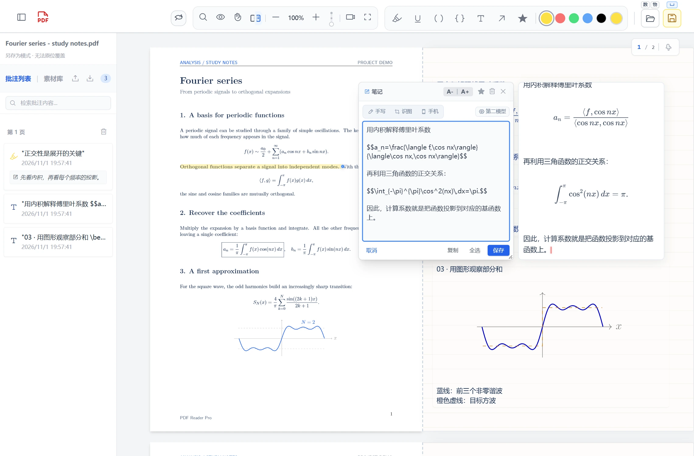
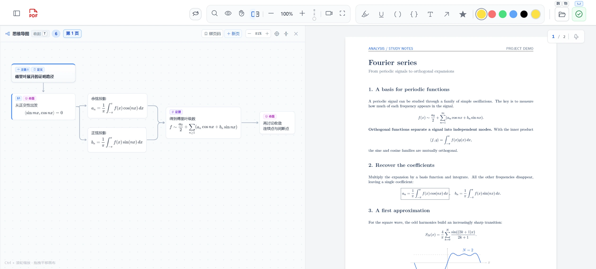
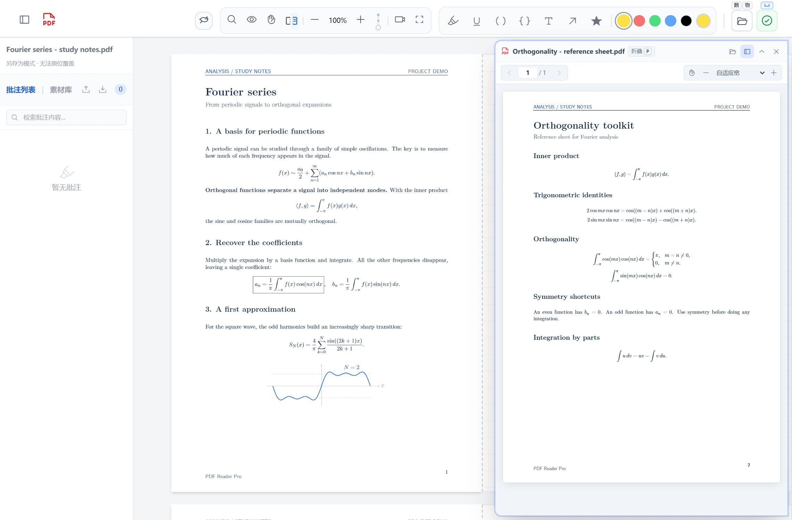
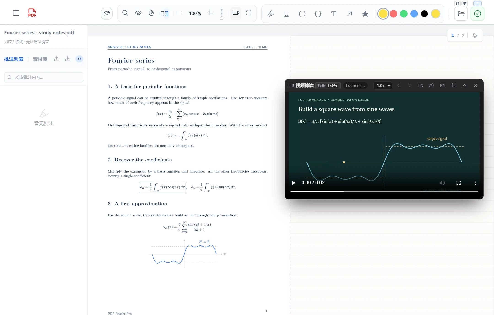

<div align="center">

# PDF Reader for Mathematicians and Physicists

**为数学与物理学习打造的本地 PDF 工作台**

阅读教材 · 书写推导 · 整理导图 · 同步观看课程

[快速开始](#快速开始) · [功能亮点](#功能亮点) · [使用指南](#使用指南) · [可选配置](#可选配置) · [开发与贡献](#开发与贡献)

</div>

PDF Reader Pro 将 PDF 阅读、矢量批注、LaTeX 笔记、思维导图和课程视频放进同一个浏览器界面。你可以在教材旁补全推导，把证明整理成导图，用手机手写公式，再将笔记保存在本地。

A local-first PDF workspace for mathematics and physics, with LaTeX/TikZ notes, mind maps, floating lecture videos, and optional AI-assisted handwriting recognition.

> **先从离线阅读开始。** 阅读、常规批注、普通公式排版和本地视频不需要模型 API。AI 对话、翻译、公式识别与云端同步按需配置；TikZ 绘图使用本机 TeX 工具链。



## 功能亮点

| 功能 | 可以做什么 |
| --- | --- |
| **专注阅读** | 多级目录、全文正则检索、逻辑页码、护眼模式、批注隐藏，以及独立 PDF 对照小窗。 |
| **在书页上补推导** | 高亮、下划线、直线、括号、大括号、箭头、图章与文本块；页面右侧可展开等宽草稿区。 |
| **LaTeX 与 TikZ** | 行内与独立公式、编辑时实时预览、速录与参数占位符跳转；支持本机编译 TikZ 图形。 |
| **推导式思维导图** | 多条主链、并行分支、节点汇合、多页签与 PDF 页码绑定；节点可混排文字、公式和 TikZ。 |
| **边看网课边读教材** | 悬浮视频窗口、本地文件夹播放列表、倍速、SRT/VTT 字幕、局部框选放大，以及 B 站网址播放。 |
| **手机变成手写板** | 浏览器扫码连接、彩色笔迹、无限画布、套索与矩形选择、缩放平移、分页草稿和防误触开关。 |
| **可选 AI 辅助** | 文字与图片对话、划词查询、段落翻译、图片或手写公式识别；按功能配置接口与模型。 |
| **保存与备份** | 本地草稿恢复、批注撤销/重做、批注 JSON 导入导出，以及可选 GitHub/Gitee 批注库同步。 |



## 快速开始

### 运行环境

| 组件 | 用途 |
| --- | --- |
| **Windows + Python 3.10 或更新版本** | 主要使用环境；安装 Python 时将其加入 PATH，并保留 tkinter 组件供本机文件选择器使用。 |
| **Edge 或 Chrome** | 打开阅读器；文件访问、视频格式和部分交互能力取决于浏览器支持。 |
| **Pillow** | 图片处理、公式识别和二维码等功能所需，由 `requirements.txt` 安装。 |
| **XeLaTeX + dvisvgm（可选）** | 仅在使用 TikZ 图形时需要；普通公式使用内置 KaTeX。 |
| **模型 API（可选）** | 仅在使用对话、翻译或识别等 AI 功能时需要。 |

前端脚本、样式、字体和主要浏览器依赖随仓库提供。**日常使用不需要 Node.js、npm 或前端构建。**

### 获取并启动

在 PowerShell 中执行：

```powershell
git clone https://github.com/bootyeah/Pdf-Reader-for-Mathematicians-and-Physicists.git pdf-reader
cd pdf-reader
python -m pip install -r requirements.txt
.\start.bat
```

也可以从 GitHub 下载仓库 ZIP，解压后安装依赖，再双击 `start.bat`。

启动器会运行本机 Python 服务并打开浏览器。如果没有自动打开，请访问 [http://127.0.0.1:8080](http://127.0.0.1:8080)。安装好依赖后，基础阅读与批注可离线使用。

需要手动启动、暂不打开浏览器时：

```powershell
python app/server.py --no-browser
```

### 第一次使用

1. 点击右上角文件夹图标，选择一份 PDF。
2. 用高亮工具标出重点，或用文本工具在页面上添加笔记。
3. 在笔记中输入 `$E=mc^2$`，查看公式预览；编辑完成后保存。
4. 按 `Ctrl+S` 保存文档。重新用本阅读器打开保存后的 PDF，可以继续编辑这些批注。

右上角「打开」按钮上方有两个快捷文件夹入口，右键可设置各自的名称与路径。将常读教材目录放在这里，可以减少反复浏览文件夹的操作。

## 使用指南

### 在教材旁写公式与画图

文本块、批注附注和导图节点支持 LaTeX 公式。编辑区旁的预览会随文字、光标、滚动与缩放更新；右侧草稿区适合放置书页中写不下的推导。



例如，将下面这段内容放入文本块：

```latex
设 $f(x)=e^{-x^2}$。由微积分基本定理，
$$
\frac{d}{dx}\int_0^x f(t)\,dt = f(x).
$$
```

内置速录支持 `mk`、`dm`、`fr` 等触发词，并可用 `Tab` 在参数占位符之间跳转。通过 `Snippet-Manager.bat` 可以搜索、编辑和试用速录规则。

配置好本机 TeX 工具链后，也可以插入 TikZ，例如：

```latex
\begin{tikzpicture}[node distance=2.5cm]
  \node (a) {$x(t)$};
  \node (b) [right of=a] {$\dot{x}(t)$};
  \draw[->] (a) -- node[above] {$\frac{d}{dt}$} (b);
\end{tikzpicture}
```

普通公式由浏览器排版，TikZ 则由本机 XeLaTeX 编译并转换为 SVG。两者的安装需求见下方[可选配置](#可选配置)。

### 用导图梳理证明与知识关系

点击工具栏的思维导图入口或按 `T` 展开面板。导图支持多条主链、并行分支与汇合，适合梳理定理依赖、证明路径和章节结构。

- 在节点中混排文字、公式与 TikZ 图形。
- 使用多个导图页签整理不同主题，并为导图页绑定 PDF 页码。
- 从绑定位置回到教材，继续阅读对应的定义或证明。
- 导图数据随当前文档的批注一起保存，支持撤销与重做。



需要对照另一本书或论文时，从「打开」按钮的悬停菜单显示 PDF 对照小窗；小窗有独立的页码、缩放与阅读位置。



### 让课程视频留在教材旁

按 `F9` 显示播放器。可以选择本地视频，也可以通过链接入口输入 B 站视频网址或受支持的视频直链。

- 本地视频可按同文件夹的自然排序切换上一集、下一集。
- 支持倍速、外挂 `.srt` / `.vtt` 字幕和视频全屏。
- 框选讲义或板书区域后，可放大局部观看，并通过原画预览调整选区。
- B 站视频支持分 P/合集列表、扫码登录与清晰度选择；实际清晰度取决于账号权限和视频源。



视频能否解码也取决于浏览器。选到文件并不代表浏览器支持其中的所有编码。

### 用手机写公式与整段草稿

文本编辑框中的公式面板提供 **手写、识图、手机** 三种输入方式：

1. 用鼠标或触控笔书写，或从 PDF 框选、粘贴、选择公式图片。
2. 也可以扫描二维码，用手机浏览器书写，电脑端查看同步笔迹。
3. 主动点击识别，检查 LaTeX 结果，再插入编辑器光标处。

再次点击已选中的文本工具可打开独立手写草稿白板，用于记录较长的推导。它支持手机多页草稿、笔迹选择与移动，以及识别为包含文字和公式的 LaTeX 段落；结果可预览、修改、复制或保存为 `.tex`。

<p align="center">
  
</p>

手机连接可选「同一 Wi-Fi」或「互联网」。互联网方式使用 Cloudflare Quick Tunnel，需要联网；首次使用可能下载 `cloudflared`。手机只需要浏览器，电脑需保持服务运行。

## 可选配置

### AI 接口

双击 `API-Manager.bat`，为对话、词典、翻译及公式识别等功能分别设置接口地址、API Key 和模型。管理器还提供连接测试、备用模型、代理与提示词配置。

- 接口使用 **OpenAI 兼容的 Chat Completions 协议**；图片对话和公式识别需要模型具有相应的视觉能力。
- 不同功能可以使用不同供应商，也可以共用 Key。无需为启用 AI 而修改 Python 源码。
- 内置对话支持流式回答、图片输入与公式/TikZ 展示；查询和识别由你主动发起。
- 配置保存在本机 `.api-manager/settings.json`。配置与备份包含密钥，分享文件或提交代码前应将其排除。

模型调用可能产生供应商费用。选择文字、图片或手写内容进行查询时，相应内容会发送给所配置的服务；这与本地阅读、批注和排版是不同的数据路径。

### TikZ 工具链

安装包含所需宏包的 TeX 发行版，例如 TeX Live，并确保以下命令可在终端运行：

```powershell
xelatex --version
dvisvgm --version
```

`dvisvgm` 还需要具备 PDF 输入转换能力。项目会调用 `xelatex` 生成 PDF，再通过 `dvisvgm --pdf` 转成 SVG。

双击 `LaTeX-Manager.bat` 可管理 TikZ 宏包、绘图库和绘图环境；实际配置位于 [`static/config.js`](static/config.js)。默认配置包含 TikZ、PGFPlots、tikz-cd、circuitikz、forest 等扩展，TeX 安装中需要具备相应宏包。管理工具修改配置，不负责安装 TeX 宏包。

### 云端批注库

如果希望在不同设备间备份或取回批注，可以配置 GitHub 或 Gitee 仓库。以 [`cloud_config.example.json`](cloud_config.example.json) 为参考，在本机 `cloud_config.json` 中填写自己的仓库与令牌，并启用同步。

- 同步的是**批注 JSON，不包含 PDF 文件**；批注中的文字和笔记仍属于上传内容。
- 保存文档时可上传批注，断网时进入待传队列；云端更新可按需合并或覆盖。
- 建议使用自己的私有批注仓库。不要把真实令牌提交到这个公开项目中。

不配置云端，也可以从批注侧栏导出 JSON 作为独立备份。

## 保存与数据

| 保存位置 | 作用 |
| --- | --- |
| **浏览器本地存储** | 恢复阅读状态与未写回 PDF 的本地草稿。清理浏览器数据、切换浏览器或站点地址可能影响恢复。 |
| **PDF 文件** | 点击保存或按 `Ctrl+S` 后，将本阅读器的批注与导图数据写入 PDF；有原位写入能力时覆盖原文件，否则另存为或下载副本。 |
| **批注 JSON** | 从侧栏导出，用于单独备份和在本阅读器中导入。 |
| **GitHub/Gitee 仓库** | 启用云端批注库后，保存批注 JSON 的远端副本。 |

**本地草稿恢复不等于已经保存到 PDF。** 阅读器使用专用元数据保存批注；这不是将批注扁平化到页面的通用导出格式，其他 PDF 阅读器不一定能显示这些笔记。继续编辑时，请用本项目重新打开保存后的文件。

保存按钮上方的小型 **「␣」开关**默认开启：在阅读器区域按空格时，既唤起抓手，也会在存在未保存修改时保存。关闭这个开关后，空格只唤起抓手；保存按钮和 `Ctrl+S` 仍然可用。

本机阅读器服务监听 `127.0.0.1:8080`。手机连接使用独立的手写服务；互联网模式会经 Cloudflare 转发该手写会话，完整配对链接应只分享给自己的设备。

## 快捷键

快捷键会根据阅读器、编辑器或播放器的焦点与鼠标位置生效。

| 快捷键 | 功能与适用位置 |
| --- | --- |
| `Ctrl+S` | 保存当前文档。 |
| `Ctrl+F` | 打开阅读器全文检索。 |
| `Ctrl+Z` / `Ctrl+Y` | 撤销 / 重做批注操作；输入框保留自身编辑行为。 |
| 按住 `Space` 并拖动 | 在阅读器中临时使用抓手；是否同时保存由「␣」开关控制。 |
| `H` / `U` | 在阅读器中切换高亮 / 下划线工具。 |
| `T` | 展开 / 收起思维导图。 |
| `F10` | 显示 / 隐藏 PDF 对照小窗。 |
| `Tab` | 编辑 LaTeX 时跳转到下一个速录参数占位符。 |
| `Ctrl+Enter` | 在笔记编辑器中提交；在独立白板中发起识别。 |
| `V` | 独立白板显示时折叠 / 展开白板。 |
| `F9` | 显示 / 隐藏视频播放器。 |
| 单按 `Shift` | 播放器打开时折叠 / 展开窗口，折叠时继续播放。 |
| `Z` / `X` | 已加载视频时，以 0.1× 步长减速 / 加速。 |
| `Space`、`←` / `→` | 鼠标悬停在播放器内时，播放暂停、后退 / 前进 5 秒。 |

## 常见问题

**可以直接双击 HTML 使用吗？**

建议始终通过 `start.bat` 启动。文件选择、原位保存、TikZ、视频服务和模型调用等功能需要本机 Python 服务；直接打开 HTML 不是完整的运行方式。

**普通公式可显示，但 TikZ 出图失败？**

两者使用不同的引擎。检查 `xelatex`、`dvisvgm --pdf` 和对应 TeX 宏包是否可用，安装或调整 PATH 后重启阅读器服务。

**启动时提示 8080 端口被占用？**

启动器会复用同一目录已运行的实例。其他程序或另一份阅读器占用端口时，需要先关闭相应服务，再启动当前目录的版本。

**能在 macOS 或 Linux 上运行吗？**

项目主要面向 Windows，启动脚本和部分文件、窗口操作使用了 Windows 集成。其他系统可从 `python app/server.py` 尝试启动，但目前不承诺完整的跨平台体验。

## 开发与贡献

项目采用 **原生 JavaScript 单页界面 + Python 本地 HTTP/API 服务**。主要职责如下：

```text
static/              阅读器页面、样式、脚本与本地浏览器依赖
  js/                阅读、批注、导图、视频、公式输入等模块
  config.js          LaTeX/TikZ 配置与速录规则
app/                 本机服务、路由与功能服务
  services/          云同步、图形编译、视频、公式与手机连接
  server.py          服务入口
tex/                 图片公式识别
airtex/              手机手写页面与笔迹处理
tools/               API、LaTeX 与速录管理工具
tests/               Python 与真实浏览器回归测试
```

长文档采用视口附近的页面调度和有界位图缓存；批注与目录增量更新，文档身份识别及内嵌批注读取放在独立 Worker 中。普通公式由 KaTeX 渲染，TikZ 复用本机编译缓存。

### 测试

Python 回归测试：

```powershell
python -m unittest discover -s tests -p "test_*.py"
```

浏览器回归另外需要 Node.js、Playwright、Sharp 与 Edge。安装测试依赖并指定其位置后，可以运行主阅读器回归：

```powershell
npm install --no-save --package-lock=false playwright sharp
$env:READER_TEST_NODE_MODULES = Join-Path (Get-Location).Path "node_modules"
node tests/reader-regression.cjs
```

可通过 `READER_TEST_BROWSER` 指定浏览器路径，通过 `READER_TEST_PYTHON` 指定后端测试使用的 Python。详细场景与依赖见 [`tests/README.md`](tests/README.md)；涉及真实联网服务的测试请先阅读对应脚本说明。

### 反馈与改进

欢迎提交 [Issue](https://github.com/bootyeah/Pdf-Reader-for-Mathematicians-and-Physicists/issues) 或 [Pull Request](https://github.com/bootyeah/Pdf-Reader-for-Mathematicians-and-Physicists/pulls)。报告问题时请提供运行环境、复现步骤、预期与实际行为；如需附 PDF，请尽量使用可公开的最小示例。

修改时请保持功能范围清晰，并根据涉及的阅读、保存、公式、导图或视频模块运行相应回归。提交内容中不应包含个人教材、密钥、登录信息或本机运行数据。

## 致谢与许可

项目使用 PDF.js、pdf-lib、KaTeX、localForage、Tailwind CSS、Phosphor Icons、dash.js 与 Pillow 等组件，感谢这些项目及其贡献者。第三方组件遵循各自的许可证。

当前仓库尚未附带项目级 `LICENSE` 文件；使用或再分发本项目代码前，请与维护者确认授权范围。
